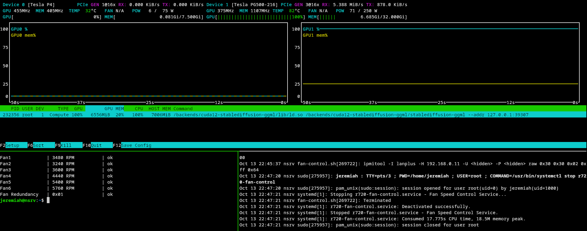
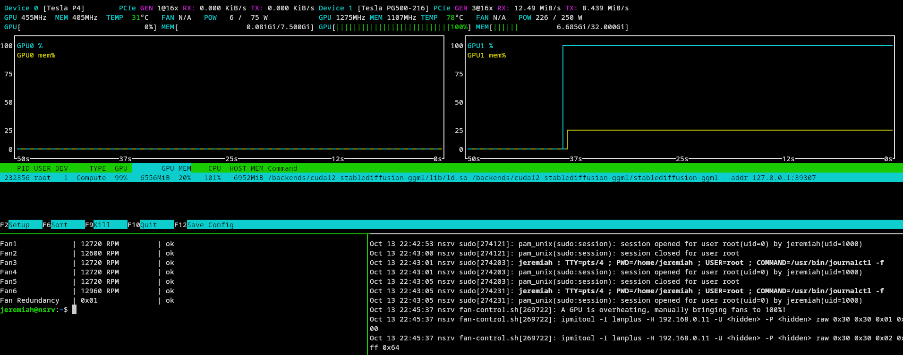
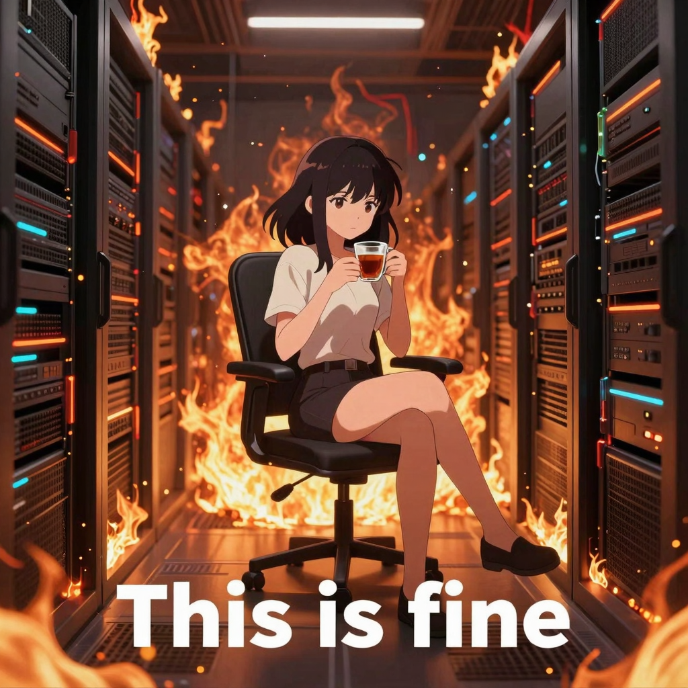

# Poweredge R720 fan control script

Monitors GPU temperature via `nvidia-smi` and overrides fan speed when threshold is exceeded

Contains a systemd service for this as well

## Requirements

 - awk
 - bash
 - grep
 - ipmitool
 - nvidia-smi

## Updating / Installation (recommended, optional)

Install / Update with `./install.sh`

A fresh install will do the following:
 1. Create a dedicated fan control user/group (fanctrl/fanctrl)
 2. Install the systemd service and utility into /usr/share/r720-fan-control
 3. Enable and start the systemd service

## Configuration

See `/usr/share/r720-fan-control/config.sh`

## Removal

Removal can be done with `/usr/share/r720-fan-control/uninstall.sh`

## Usage

Or you can simply run `./fan-control.sh` as a normal user, however the
program will not run in the background and if the shell it is running in
ever closes or the system reboots fan control will no longer be running

If a SIGINT is provided to `fan-control.sh` a trap will be called ensuring
that the fans are returned to automatic control

IPMI Commands are logged for ease of troubleshooting, currently there is no
way to disable this so it is recommended you make sure your log rotation
works if you plan on running in an extremely high uptime environment. If the
script has to kick in 1000 times a day, this will produce ~50MB over the span
of a year. So make sure you have at least 50MB of free disk space.

## Systemd service

The `fan-control.service` file consists of a simple systemd service that will
start after `network.target` is reached, and auto-restart after 10 seconds if
an error is encountered.

## Reliabilty and security

This software is not designed for security or reliability. By using this
software you are accepting the risk of any damages caused by said software.

IPMI is inheriently not secure, I did put some effort to at least
add some basic permissions to help hide the username / password in the
configuration file used. The username and password will also be replaced
with `<hidden>` in the system log as well.

## Testing / Benchmarking

### Hardware configuration

 - Dell Poweredge R720 running Proxmox 8.3 w/ 32x Intel(R) Xeon(R) CPU E5-2667 v2 @ 3.30GHz and 384GB of RAM
 - VM is on SSD storage, w/ 8 host NUMA aware cores, 32GB of RAM, Q35 BIOS
 - Tesla V100 in slot 04:00 has pass-through w/ all-features and BAR support
 - Positioned in slot opver power supplies for optimal airflow in server

### Software configuration

```sh
POST /v1/images/generations
{
  "model": "Z-Image-Turbo",
  "prompt": "Anime style girl sipping tea while sitting on a chair that is positioned in the middle of a burning datacenter. With the this is fine text on the bottom.",
  "n": 1,
  "size": "1024x1024",
  "seed": 1337
}
```

Endpoint served via the LocalAI stablediffusion-ggml backend (model was already loaded in VRAM for all tests)

### Results

Fan control             | Time    | Core clock | Memory clock | Temperature | Power  | Fan RPM
------------------------|---------|------------|--------------|-------------|--------|------------
Disabled with no load   | N\A     | 1260 MHz   | 1107 MHz     | 47 C        | 41 W   | ~4000 RPM
Disabled with full load | 3:28.98 | 375 MHz    | 1107 MHz     | 82 C        | 71 W   | ~4000 RPM
Enabled with full load  | 1:08:12 | 1275 MHz   | 1107 MHz     | 78 C        | 226 W  | ~12700 RPM

#### System running without fan control



#### System running with fan control



#### Generated image



## Versions / Tags

 - v1.0
   - Initial release
 - v1.1
   - Wait for network.target in systemd service
   - Added benchmark / testing results to documentation

